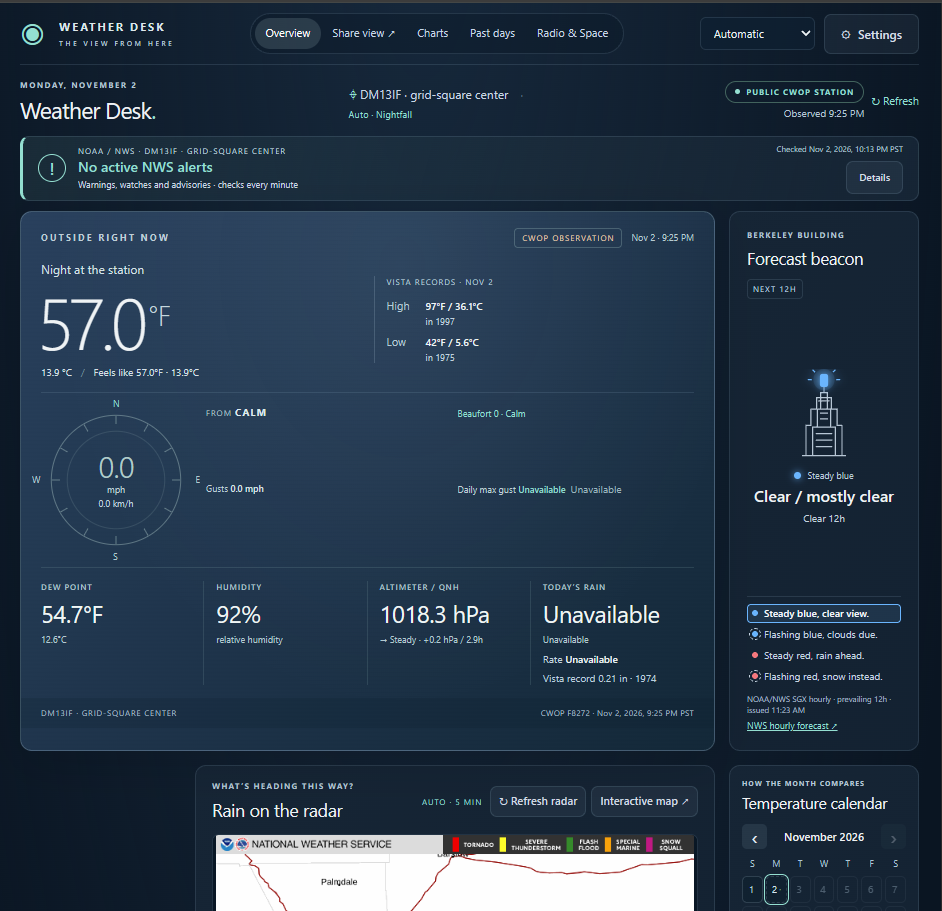

# Shannon's Weather Desk

A private, self-hosted weather dashboard that runs on your own computer, or in
Docker on a home server. It combines a personal weather station (or nearby
public stations), NWS forecasts, alerts, radar, climate comparisons, tides, sky
times, lightning and ham-radio space weather in one page you open in your
browser. No account, cloud service or subscription is needed to get started, and
everything you save stays on your machine.

> **Edition:** US, build 29.
> <!-- Add a screenshot here:  -->

## What it shows

- **Current conditions** from a connected Ambient personal station, or
  automatically from the nearest qualifying public station (CWOP/NOAA). Public
  stations must report measured rainfall; missing data is never shown as zero.
- **Forecast beacon**: a building-style light driven by the NWS hourly forecast
  for the next 12 hours (steady blue clear, flashing blue clouds, steady red
  rain, flashing red snow), with the rhyme shown beneath it.
- **Alerts and radar**: active NOAA/NWS warnings, watches and advisories, and
  NOAA radar refreshed every five minutes.
- **Climate and history**: temperature and rain compared with 1991-2020
  normals, a temperature calendar, year-to-date rain, and a "past days" view.
- **Tides, sun and moon** for your location.
- **Lightning nearby** from NOAA GOES satellites, no key required.
- **Radio & Space**: NOAA SWPC space weather and KC2G propagation maps and
  circuit predictions for amateur radio.
- **Optional nearby personal stations** through your own Weather Underground
  API key.

## Choose how to run it

| You have | Use |
| --- | --- |
| A Windows 10/11 PC (64-bit Intel/AMD) | [Windows](#windows) (nothing to install) |
| Python 3.10+ on Windows, macOS or Linux | [Installed Python](#macos--linux--raspberry-pi) |
| A server, NAS or VM running Docker | [Docker](#docker) |

## Windows

Python is included, so there is no pip, Node or extra software to install.

### 1. Get the files (pick one)

**Clone with Git**

```
git clone https://github.com/OWNER/weather-desk.git
cd weather-desk
```

**GitHub Desktop:** choose **File > Clone repository** and select this repo.

**Download a ZIP:** on the repository page click **Code > Download ZIP**, then
right-click the ZIP and choose **Extract All**. Always extract it to a normal
folder first. Do not run it from inside the ZIP.

### 2. Start it

Double-click **START-WEATHER-DESK.bat**.

- The first run prepares the included Python and checks its files. This takes a
  moment, needs no internet access, and does not change your system PATH,
  registry or PowerShell policy.
- Your browser opens <http://127.0.0.1:8765/>.
- **Keep the console window open.** Close it, or press Ctrl+C, to stop.

If Windows SmartScreen warns about the `.bat` file, choose **More info > Run
anyway**. The launcher is a plain text script you can open and read.

### 3. First-time setup

In **Settings**, choose your location. Leave readings on **Automatic**, or
connect your Ambient station with its API key, application key and optional
MAC address, then click **Remember this station** to save the connection
locally.

### Other Windows launchers

| File | What it does |
| --- | --- |
| `START-WEATHER-DESK.bat` | Runs with the bundled Python, this PC only |
| `START-WITH-INSTALLED-PYTHON.bat` | Uses your own Python 3.10+ instead |
| `START-WEATHER-DESK-LAN.bat` | Bundled Python, **also open to your home network** |
| `START-WITH-INSTALLED-PYTHON-LAN.bat` | Installed Python, also open to your home network |
| `CHECK-WEATHER-DESK-RUNTIME.bat` | Verifies the bundled files and tests imports, TLS and SQLite. Keep its output if startup fails |

### Updating

- **Cloned with Git:** close the console, run `git pull`, and start it again.
  Your settings are kept, because the `private` folder is never part of the
  repository.
- **Downloaded a ZIP:** close the console and keep the old folder as a backup.
  Extract the new download into a new folder, then copy your old **private**
  folder into it to keep your connection, settings and history.

## macOS / Linux / Raspberry Pi

Python 3.10+ is the only requirement (standard library only, no `pip install`):

```sh
python3 -I -X utf8 -B launch_weather.py --installed-python --open
```

Add `--lan` to let other devices on your network connect. Press Ctrl+C to stop.
The `start-weather-desk.command` file does the same on macOS (you may need to
run `chmod +x start-weather-desk.command` once).

## Docker

Replace `OWNER` with the account that publishes the image, in lowercase.

### Docker Compose

```yaml
services:
  weather-desk:
    image: ghcr.io/OWNER/weather-desk:latest
    container_name: weather-desk
    ports:
      - "8765:8765"
    restart: unless-stopped
    volumes:
      - weather-data:/app/private

volumes:
  weather-data:
```

Save it as `docker-compose.yml`, run `docker compose up -d`, then open
`http://<host-ip>:8765/` from any device on your network.

### Single command

```
docker run -d --name weather-desk -p 8765:8765 -v weather-data:/app/private --restart unless-stopped ghcr.io/OWNER/weather-desk:latest
```

### Build it yourself

```
git clone https://github.com/OWNER/weather-desk.git
cd weather-desk
docker compose up -d --build
```

(Use a compose file with `build: .` in place of `image:`.)

### Updating the container

```
docker compose pull
docker compose up -d
```

Your settings and history live in the `weather-data` volume and survive updates.
Do not delete the volume, or run `docker compose down -v`, unless you want to
start over. In Portainer, leave "remove associated volumes" unticked.

### Docker notes

- To reach it by a hostname instead of an IP address, add this to the service
  (it replaces the default command):
  `command: ["python", "-X", "utf8", "server.py", "--lan", "--allow-host", "your-hostname"]`
- The container reports its own health. Docker shows it as **healthy** once
  the server is answering.

## Using it from other devices on your home network

By default the dashboard only listens on the computer it runs on. To open it from
a phone or tablet, start it with `--lan` or use one of the `-LAN` launchers. The
console prints the addresses to use, for example `http://192.168.1.50:8765/`.
The Docker image already runs in this mode.

**There is no password.** Anyone on your network who can reach the port can open
the dashboard and change its settings. Use it only on a network you trust, allow
it through your firewall on **private** networks only, and never forward port
8765 from your router to the internet.

Requests are accepted only for `localhost`, private-network IP addresses and
this computer's own name. To reach it by another name, add `--allow-host <name>`
(repeatable).

## Troubleshooting

**Windows: the page loads on the PC but not on a phone.** A firewall is blocking
port 8765. Allow it on private networks in Windows Defender Firewall. With
third-party security software (ESET, Norton and others), check its
blocked-connection log right after trying the phone, and allow the program or
port it names. Note that the rule must match the program that is actually
running, so a different Python path needs its own rule.

**"Port 8765 is busy."** Another copy of the dashboard is already running. Close
it, or start with `--port 8766`. If the message names a different problem (for
example a permissions error), it is describing the real cause.

**Docker on Windows with WSL "mirrored" networking.** Published ports may work
on `localhost` but not from other devices. Allow inbound traffic to WSL in the
Hyper-V firewall, using PowerShell as Administrator:

```
Set-NetFirewallHyperVVMSetting -Name '{40E0AC32-46A5-438A-A0B2-2B479E8F2E90}' -Enabled True -DefaultInboundAction Allow
```

This opens all ports of WSL guests to your network, not only this app. Restart
Docker Desktop afterward (`wsl --shutdown`, then start it again). Alternatively,
switch WSL back to its default networking mode in `.wslconfig`.

**Docker: "Permission denied" on `/app/private`.** The data volume must be
writable by the container's user (UID 1000). A freshly created volume works;
remove an old root-owned volume and recreate it.

**Docker: no logs appear.** The published image sets `PYTHONUNBUFFERED=1`. If you
built your own image, add `ENV PYTHONUNBUFFERED=1` to the Dockerfile.

**Won't start at all.** Run **CHECK-WEATHER-DESK-RUNTIME.bat** and keep the full
output, or on installed Python run
`weather-desk.bat --installed-python --diagnose` in a terminal.

## Your data stays with you

Credentials, preferences, observations and caches are saved in the local
`private/` folder (the `weather-data` volume in Docker). On Windows, remembered
keys are encrypted for your account; elsewhere they are kept in an owner-only
file. **Never commit or share your `private/` folder.** **Forget station**
removes a saved connection. Weather is fetched from public feeds, and saved
history stays local.

## Data sources

NOAA/NWS (forecasts, alerts, radar, observations, tides), NOAA MADIS/CWOP,
NOAA GOES lightning, NOAA SWPC, KC2G, RCC-ACIS climate data, and optionally
Ambient Weather and Weather Underground with your own keys. Please respect each
provider's terms of use.

## More documentation

[`docs/DETAILS.md`](docs/DETAILS.md) covers startup internals, station
selection rules, rainfall and climate calculations, and verification notes.

## Credits and license

Created by Shannon. <!-- add name and links as she prefers -->
Third-party notices are in [`third-party/`](third-party/).

License: _to be chosen by the author before release (for example MIT)._
